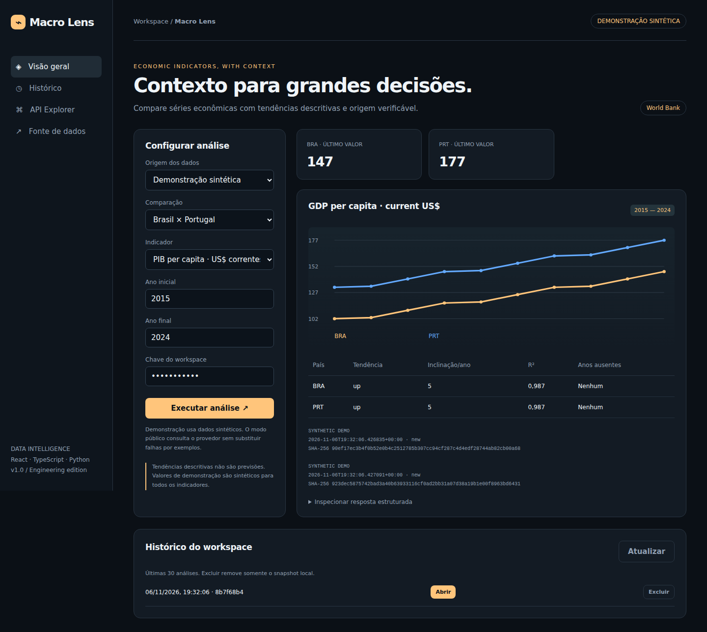
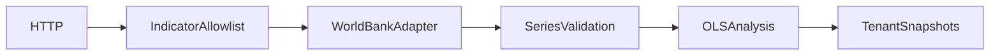

# Macro Lens

[](https://github.com/welkerfernandes/macro-lens/actions)



Comparações econômicas precisam explicitar unidade, período, dados ausentes e limites da tendência calculada.

Plataforma executável com dashboard responsivo, API autenticada e integração real com **World Bank Indicators API**.


## Funcionalidades

Comparação entre até três países; PIB per capita, inflação e desemprego; janela temporal validada; regressão linear descritiva; R²; anos ausentes sem interpolação; gráficos; histórico e proveniência por país.

## Executar

Python 3.12 ou 3.13. Na pasta do projeto:

```powershell
python -m venv .venv
.venv\Scripts\Activate.ps1
python -m pip install -r requirements.txt
python -m uvicorn app.main:app --host 127.0.0.1 --port 8203
```

Linux/macOS: `source .venv/bin/activate`.
Abra http://localhost:8203 e execute a análise.
O modo inicial da interface é **demonstração sintética**. Para consultar a fonte,
selecione **Consultar API pública**. Falhas do provedor são exibidas, sem substituição silenciosa por exemplos.
O contrato OpenAPI está em http://localhost:8203/docs.

Chaves locais: `local-alpha` e `local-beta`. A identidade do workspace é derivada da chave,
nunca de um header arbitrário de tenant. Configure `API_KEYS` antes de exposição externa.

## API

| Método | Rota | Função |
| --- | --- | --- |
| POST | `/api/analyze` | Consultar fonte, analisar e persistir snapshot |
| GET | `/api/history` | Últimos 30 snapshots do workspace |
| DELETE | `/api/history/{id}` | Excluir snapshot próprio |
| GET | `/health` | Liveness do processo |

Operações de negócio exigem `X-API-Key`. Exemplos completos estão na interface e no contrato `/docs`.

```bash
python -m pytest -q
docker build -t macro-lens .
docker run --rm -p 8203:8203 macro-lens
```

O banco no container é efêmero sem volume. Os testes usam banco temporário e transporte HTTP simulado,
sem depender da disponibilidade externa. O workflow testa Python 3.12 e 3.13.

## Arquitetura



O adaptador HTTP tem hosts permitidos, timeout explícito, cache TTL de cinco minutos,
capacidade limitada a 128 entradas e até duas tentativas para timeout/erro de rede ou erro 5xx inicial.
Não segue redirecionamentos nem repete 429. Não entrega cache expirado como se fosse atual.
O cache contém somente respostas públicas e é local ao processo; snapshots são isolados por workspace.

Leia [arquitetura](docs/architecture.md), [metodologia](docs/methodology.md),
[fontes](docs/data-sources.md), [operação](docs/runbook.md) e [segurança](SECURITY.md).

## Limites conhecidos

Não é recomendação financeira. PIB em dólares correntes não corrige inflação nem paridade de poder de compra. Séries podem ser revisadas pelo provedor, terminar em anos diferentes ou conter lacunas. Países são consultados sequencialmente, sem snapshot temporal atômico entre fontes. Se um país falhar, nenhuma análise parcial é persistida.

## Evolução

Adicionar metadados e última atualização da fonte, testes de revisão de séries, exportação versionada e avaliação de robustez das tendências a outliers e mudanças estruturais.

## Implementação em Rust

Motor nativo integrado ao fluxo de análise, com testes próprios. Veja [execução e protocolo](docs/polyglot.md).

## Dashboard React + TypeScript

`web/` contém o frontend tipado, com estado de consulta, histórico e gráficos SVG. Execute `npm ci` e `npm run build` dentro de `web/`; a API servirá o build em `/`. Para desenvolvimento use `npm run dev` com a API ativa. Sem build, a API mantém uma console HTML funcional de apoio.

A imagem Docker compila o frontend e o motor nativo e j? ativa o componente Go/Java/Rust correspondente. O modo Python continua dispon?vel na execu??o local sem NATIVE_ENGINE.

## Verificação em navegador

O job `browser` da CI executa fluxos em Chromium, verifica a versão de 390 px e publica capturas como artifact `dashboard-screenshots`. Execute `npm install` em `ui/`, `npx playwright install chromium` e `node ui/smoke.cjs` na raiz com a API em localhost:8000 para repetir.

Consulte o [registro de validação](docs/validation.md) e a [captura mobile](docs/mobile.png).
